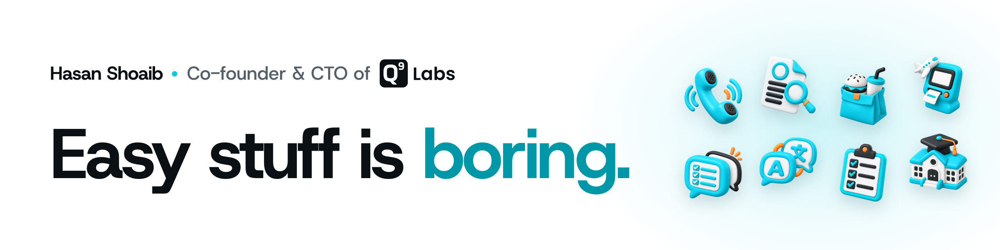

I'm Hasan, co-founder and CTO of [Q9 Labs](https://q9labs.ai). AI is smart enough now. Most of it is just unemployed, so we give it jobs: answering calls, interviewing applicants, taking orders. I started programming at 13 and I still like the hard problems best.

[X](https://x.com/realhasanshoaib) · [LinkedIn](https://linkedin.com/in/hasanshoaib) · [hasanshoaib.com](https://hasanshoaib.com)

## Q9 Labs

### Products

- **[Ava](https://q9labs.ai/products/ava)**: Voice agents that pick up every call, book the appointment, and update your CRM
- **[Nura](https://q9labs.ai/products/nura)**: Every applicant gets a real interview. You just read the shortlist
- **[Mesa](https://mesa.q9labs.ai)**: Voice ordering for restaurants, from the drive-through to the table
- **[Track](https://track.q9labs.ai)**: Chat, tasks, and an AI that only sees what you're allowed to see
- **[Terminal](https://terminal.q9labs.ai)**: An airport help desk that speaks every language and never takes a break
- **[Murmur](https://murmur.q9labs.ai)**: Live translation for talks. The speaker talks, the room reads along in its own language
- **[Flow](https://q9labs.ai/products/flow)**: Forms you talk to. You speak, the fields fill in, and you check it before it's sent
- **[Edli](https://q9labs.ai/products/edli)**: A school operating system with AI built in, for leaders, teachers, students, and parents

### Apps

- **[Saypad](https://saypad.q9labs.ai)**: Talk, and it types at your cursor. On Mac and Android
- **[Spend](https://play.google.com/store/apps/details?id=com.q9labs.ai.spend)**: Say what you spent and it keeps the budget
- **[Diet Bite Life](https://apps.apple.com/us/app/diet-bite-life/id6779639849)**: Meal plans and nutrition logging for iPhone

### Open source

- **[Chalk](https://github.com/Q9Labs/chalk)**: Real-time collaboration SDK for calls and whiteboards, on React and React Native
- **[q9stack](https://github.com/Q9Labs/q9stack)**: The TypeScript toolkit and quality gates every Q9 app ships on

### In stealth

- Something for hiring teachers, in education

## Tools for agents (and the people running them)

- **[Skillbox](https://github.com/realhasanshoaib/skillbox)**: Load agent skills when they're needed, not all of them on every prompt
- **[Complain](https://complain.hasanshoaib.com)**: Lets coding agents report broken tooling instead of quietly working around it
- **[rr](https://rr.hasanshoaib.com)**: Builds one self-contained HTML document from small components, with zero dependencies
- **[TodoBar](https://github.com/realhasanshoaib/todobar)**: A menu bar queue for tasks and agent prompts

Skillbox, Complain, and rr install from my [Homebrew tap](https://github.com/realhasanshoaib/homebrew-tap).

### Skills

- **[Mobile Skills](https://github.com/realhasanshoaib/mobile-skills)**: Playbooks that get apps through App Store and Google Play review, tested on real rejections
- **[UI Vocabulary](https://ui-vocab.hasanshoaib.com)**: 133 design terms with ready prompts, so you can tell an agent exactly what you mean
- **[Spec-craft](https://github.com/realhasanshoaib/agents-home/tree/main/skills/spec-craft)**: Turns a rough idea into a spec an agent can actually build
- **[Material UI](https://github.com/realhasanshoaib/material-ui-skill)**: Native Jetpack Compose Material 3 design and review for Android
- **[Refactor contract](https://github.com/realhasanshoaib/refactor-contract-skill)** and **[Refactor vocabulary](https://github.com/realhasanshoaib/refactor-vocabulary-skill)**: Plan big refactors in waves, and talk to agents about them precisely

## Small fixes for things that annoyed me

- **[Hushfeed](https://realhasanshoaib.github.io/hushfeed/)**: Hides the X and YouTube feeds and keeps search, profiles, and videos
- **[FingerPain](https://github.com/realhasanshoaib/fingerpain)**: Counts your keystrokes without recording what you type
- **[Super Alarm](https://hasanshoaib.com/projects/super-alarm)**: An alarm you can't dismiss while half asleep
- **[Bolo](https://hasanshoaib.com/projects/bolo)**: A YouTube player with synced translation in two languages
- **[Sip](https://play.google.com/store/apps/details?id=com.hasanshoaib.sip)**: Water tracking that stays on your phone
- **[Jiffy](https://hasanshoaib.com/projects/jiffy)**: Floating notes on your Mac, stored locally
- **[Stash](https://hasanshoaib.com/projects/stash)**: Read-later across browsers, with search and sync (in store review)
- **[WhatsApp Privacy Blur](https://github.com/realhasanshoaib/whatsapp-privacy-blur)**: Blurs the WhatsApp chat list on your Mac so people behind you can't read it

## Thinking about

- Version control that remembers whether each version passed its tests, security checks, and performance budgets
- Reading with AI: books that come with explanations and visuals made for you
- Models that keep learning from every customer they talk to
